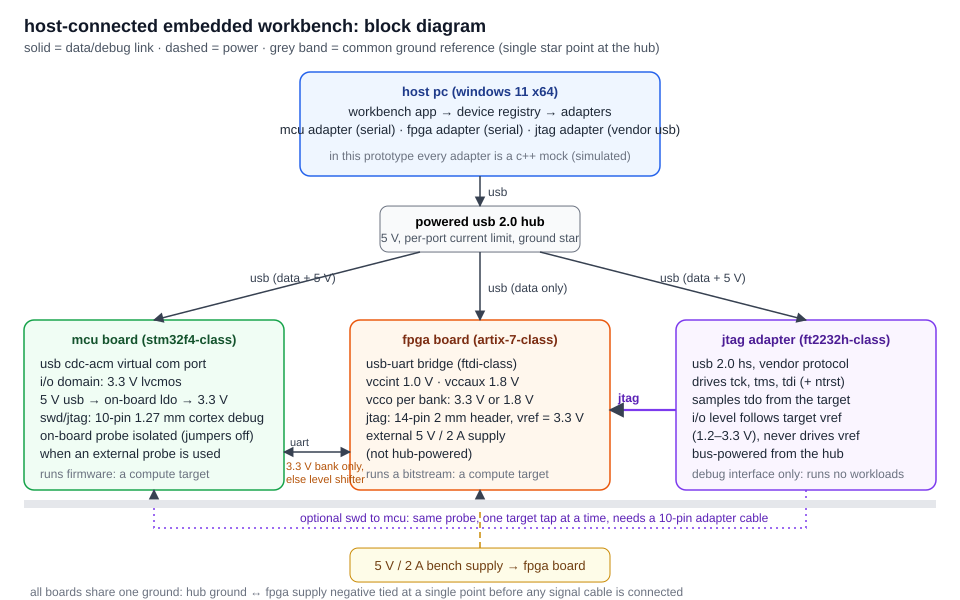

# embedded integration design (task e)

a host-connected workbench for **one microcontroller board, one fpga board and one jtag debug adapter**.
the software in this submission implements the host side with **simulated** adapters; no hardware was
connected. this document is the design those mocks stand in for.



## 1. modules

| module | role | host link | in code |
|---|---|---|---|
| host pc | runs the workbench; owns every device session | – | `DeviceRegistry` |
| powered usb 2.0 hub | one ground reference, per-port current limiting, isolates the laptop's ports | usb | – |
| mcu board (stm32f4-class, nucleo-style) | runs firmware; sends line-based telemetry | usb cdc-acm virtual com port, 115200 8n1 | `MockMcu` |
| fpga board (artix-7-class, arty-style) | runs a bitstream; soft uart in fabric | usb-uart bridge (ftdi-class), 921600 8n1 | `MockFpga` |
| jtag adapter (ft2232h-class) | debug, boundary scan, configuration of a target's tap | usb 2.0 hs, vendor bulk protocol (mpsse) | `MockJtag` |

all three implement one interface (`DeviceAdapter`: `info`, `capabilities`, `connect`, `disconnect`,
`read_telemetry`), but **the interface does not make them interchangeable**: capability reporting says what
each one can do, and only the mcu and fpga report `can_run_workloads = true`.

## 2. interface / pin-voltage table

device-specific pin numbers below are **assumptions for the named board classes** and must be checked against
the actual board's schematic before wiring (step 1 of the plan in §5).

| link | connector (assumed) | signals | voltage domain | level shifting | ownership / notes |
|---|---|---|---|---|---|
| host ↔ hub | usb-a / usb-c | d+, d−, vbus, gnd | vbus 5 V; usb signalling 3.3 V | none (usb phy) | hub is self-powered, so board current does not load the laptop port |
| hub ↔ mcu board | usb micro-b / usb-c on the board's debug usb | d+, d−, vbus, gnd | 5 V in → on-board ldo → **3.3 V** i/o | none | board is bus-powered (< 500 mA). vcp appears as a com port |
| hub ↔ fpga board (uart) | usb micro-b to the ftdi bridge | d+, d−, gnd | bridge i/o 3.3 V into a **3.3 V vcco** bank | none if the uart pins are in a 3.3 V bank | **data only**: the fpga board is powered from its own supply |
| bench supply → fpga board | 2.1 mm barrel jack | +5 V, gnd | 5 V in → on-board regulators: vccint 1.0 V, vccaux 1.8 V, vcco 3.3 V / 1.8 V per bank | – | current-limited supply (2 A). rails checked with a meter before any signal cable is attached |
| hub ↔ jtag adapter | usb mini/micro-b | d+, d−, vbus, gnd | adapter logic powered from vbus | internal buffers follow target vref | adapter is bus-powered |
| jtag adapter → fpga | xilinx-style 2 × 7, 2.0 mm: pin 2 vref, 4 tms, 6 tck, 8 tdo, 10 tdi, odd pins gnd | tck, tms, tdi (adapter → target), tdo (target → adapter), vref (target → adapter), gnd | **follows target vref** (3.3 V on this board; adapters accept 1.2–3.3 V) | done inside the adapter, referenced to vref | adapter drives tck/tms/tdi, target drives tdo. adapter **never drives vref**. one master per chain: an on-board usb-jtag circuit must be idle/unplugged when the external adapter is used |
| jtag adapter → mcu (optional swd) | arm cortex 2 × 5, 1.27 mm: 1 vtref, 2 swdio/tms, 4 swclk/tck, 6 swo/tdo, 10 nreset, 3/5/9 gnd | swdio, swclk, nreset, swo | 3.3 V (vtref) | inside the adapter | nucleo-style boards have an on-board st-link: remove its swd jumpers before connecting an external probe. only one target tap is used at a time |
| mcu ↔ fpga (data link) | 3 jumper wires | uart tx, rx, gnd | 3.3 V ↔ fpga bank vcco | **none if vcco = 3.3 V; if the fpga pins are in a 1.8 V bank, use a 2-bit translator (sn74lvc2t45-class) powered from both rails** | 33–100 Ω series resistors; never drive a 1.8 V bank from 3.3 V |

**grounding.** every board shares one ground: the hub's ground and the fpga supply's negative are tied at a
single point, and that ground is connected **before** any signal cable. this avoids ground-loop currents
through a jtag ribbon or uart wires.

**voltage domains in one line.** usb 5 V → mcu 3.3 V; external 5 V → fpga 1.0 / 1.8 / 3.3 V; the jtag
adapter's i/o voltage is whatever the target presents on vref. no two boards are assumed to share a
connector, a voltage or a protocol.

## 3. why a jtag adapter is not an interchangeable compute board

- **it executes nothing of ours.** an ft2232h-class probe is a protocol bridge: it turns usb bulk transfers
  into tck/tms/tdi edges and samples tdo. it has no user program, no application memory and nothing to
  "run" a workload on.
- **its job is defined by its target.** it only does useful work while attached to another device's tap
  (debug halt/step, boundary scan, flash or bitstream loading). on its own it has no telemetry of its own
  beyond the link state, vref and chain contents.
- **its electrical side is borrowed.** i/o levels follow the target's vref; plugging it into a different
  board changes its voltage. a compute board has its own fixed rails.
- **its protocol is different.** the mcu and fpga talk line-based uart through a com port; the probe speaks a
  vendor usb protocol and needs a jtag state-machine driver on the host.

in the software this shows up as `can_run_workloads = false` and a capability list that starts with
"debug interface only". the ui labels it "jtag debug adapter" and never offers it as a target for work.

## 4. host software design (what the mocks implement)

```
DeviceRegistry ── discover() ─► [ DeviceAdapter* mcu0, fpga0, jtag0 ]
DeviceAdapter
  info()            id, kind, model, host link, i/o level, can_run_workloads
  capabilities()    list of {name, detail}
  connect()         disconnected/faulted → connected, or timeout → faulted
  disconnect()      any → disconnected
  read_telemetry()  one frame: {device_id, sequence, fields[name, value, unit]}
  set_fault()       none | timeout_once | timeout_always   (test hook)
```

- **state machine:** `disconnected → connected → (timeout) → faulted → (connect) → connected`.
- **recoverable failure:** with `timeout_once`, the next operation waits the 400 ms timeout, returns
  `code = "timeout", recoverable = true`, and marks the link faulted. telemetry on a faulted link refuses
  with "reconnect first". the next `connect` succeeds. the ui turns the button into **retry connect**.
- **telemetry message:** deterministic sine-shaped values per sequence number (mcu die temperature, vdd,
  uptime, adc; fpga die temperature, vccint, vccaux, bitstream; jtag vref, tck, chain length, idcode
  `0x0362d093`, labelled as a simulated artix-7 xc7a35t).
- **thread safety:** each adapter has its own mutex; http requests run on separate threads.
- **labelling:** every model string ends in "(simulated)", every reply says simulated, and the ui shows a
  "simulated" badge on each card.

replacing a mock with real hardware means implementing the same interface: serial devices via win32 com-port
apis (`CreateFile("\\\\.\\COMx")`, `SetCommState`, overlapped reads with timeouts), the probe via the vendor's
d2xx/mpsse library or libusb, and discovery via setupapi device enumeration by usb vid/pid.

## 5. safe integration plan

1. **paperwork first.** get each board's schematic; replace every "assumed" cell in §2 with the real header
   pin numbers and the vcco of the bank holding the uart pins.
2. **power one board at a time.** fpga board alone on a current-limited 5 V supply; measure 1.0 / 1.8 /
   3.3 V rails. mcu board alone on the hub; measure 3.3 V.
3. **ground before signals.** tie the common ground, then plug in usb cables. confirm the com ports and the
   probe enumerate (device manager) before opening anything from software.
4. **software against mocks, then read-only real.** the workbench already runs against mocks; swap one
   adapter at a time and start with read-only actions: open/close the com port, read a line, scan the jtag
   chain for idcodes. no flash or bitstream writes in the first session.
5. **jtag with the target powered.** connect the ribbon only when vref is present; check the adapter reports
   the expected vref; one master per chain (on-board programmer idle, st-link jumpers off).
6. **inter-board link last.** confirm both ends are 3.3 V (or fit the level translator), then loopback test
   at low baud with series resistors in place; check edges on a scope if available.
7. **timeouts everywhere.** every host call has a timeout and a recoverable error path (as the mocks do);
   a stuck device must never hang the ui.
8. **disconnect in reverse order;** never hot-plug the jtag ribbon while either side is powered.

## 6. limitations

- everything is simulated: no usb enumeration, com-port io, mpsse driver or real timing.
- latencies (25–60 ms) and the 400 ms timeout are illustrative, not measured on hardware.
- pinouts are for the named board classes and are assumptions until checked against real schematics.
- no firmware, no bitstream, no fpga programming, no pcb, no esd or emc analysis.
